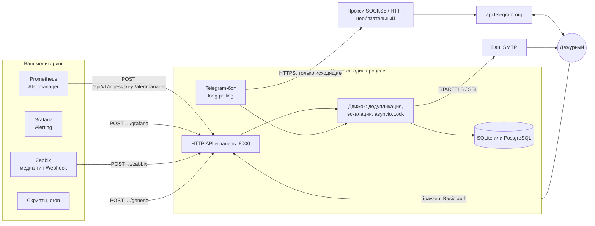
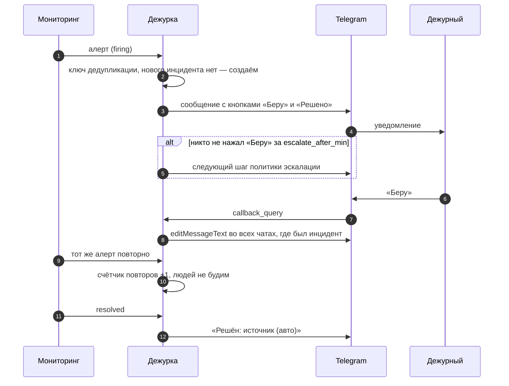
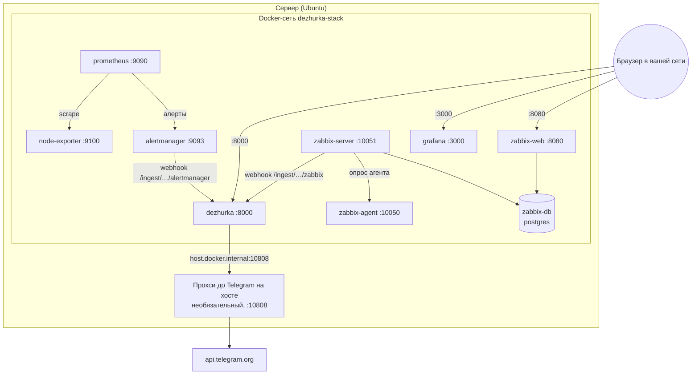

# Как устроена «Дежурка»

Схемы, потоки данных и эксплуатационные заметки. Пользовательская часть — в [README](../README.md).

## Компоненты и сеть



Главное о сети:

- **Входящие** — только порт 8000: вебхуки мониторинга, панель и REST API. Публичный HTTPS не нужен,
  сервис работает в закрытом контуре.
- **Telegram — только исходящие** соединения: бот забирает обновления long polling (`getUpdates`),
  поэтому Telegram не должен до вас достучаться, а вебхук Telegram не используется.
- **Прокси для Telegram** (`telegram.proxy`) применяется только к Bot API: из многих сетей в РФ
  `api.telegram.org` напрямую недоступен. Вебхуки мониторинга и почта ходят напрямую.
- **Один процесс** обслуживает API, эскалации и бота. Все изменения инцидентов идут через один
  `asyncio.Lock`, поэтому несколько воркеров запускать нельзя.

## Жизненный цикл инцидента



Ключ дедупликации по источникам:

| Источник | Ключ | Закрытие |
|---|---|---|
| Alertmanager, Grafana | `fingerprint` алерта | `status: resolved` (нужен `send_resolved: true`) |
| Zabbix | `{EVENT.ID}` | `{EVENT.VALUE} = 0` в Recovery operations |
| generic | поле `dedup_key` (иначе хэш заголовка) | `"action": "resolve"` |

Эскалация: шаги политики идут по очереди; на каждом шаге зовутся цели (человек или текущий дежурный
по графику), затем ждём `escalate_after_min`. После последнего шага политика повторяется `repeat` раз.
Нажатие «Беру» останавливает эскалацию. Движок проверяет таймеры каждые `tick_seconds` (по умолчанию 10 с).

## Telegram

- Привязка человека: личная ссылка `t.me/<бот>?start=<код>`, код — HMAC от `id` пользователя
  на `secret_key`. Ссылку видно в панели в разделе «Люди». Отозвать её можно только сменой `secret_key`.
- Кнопки и команды принимаются только от привязанных людей и из чатов команд, указанных в конфиге.
- Каждое отправленное сообщение сохраняется (`chat_id`, `message_id`) и редактируется при смене
  статуса, поэтому в чате остаётся одно актуальное сообщение на инцидент.
- Токен бота не попадает в логи: запросы httpx не логируются, из текстов ошибок токен вырезается.
- Если Telegram недоступен при старте, бот переподключается с паузой 5 с → 5 мин, сервис при этом работает.

## Демо-стенд (`deploy/`)



| Порт | Сервис | Доступен |
|---|---|---|
| 8000 | Дежурка: панель, API, вебхуки | из сети |
| 3000 | Grafana | из сети |
| 8080 | Zabbix web | из сети |
| 9090, 9093 | Prometheus, Alertmanager | только `127.0.0.1`, смотреть через `ssh -L 9090:127.0.0.1:9090` |
| 9100, 10050, 10051, 5432 | экспортер, Zabbix, БД Zabbix | только внутри Docker-сети |
| 10808 | прокси до Telegram на хосте | только localhost и сети Docker (закрыть файрволом) |

### Эксплуатация

```bash
sudo bash deploy/setup.sh [--zabbix]   # первая установка: Docker, .env с паролями, config.yaml
sudo bash deploy/update.sh             # git pull + пересборка; донастраивает .env старых установок
sudo bash deploy/zabbix-connect.sh     # медиа-тип, получатель и действие в Zabbix через API
```

- Секреты живут в `.env` (права 600), люди и графики — в `config.yaml`. Оба файла не в git.
- `update.sh` останавливается, если в отслеживаемых файлах есть ручные правки, и после `git pull`
  перезапускает себя новой версией, чтобы её шаги применились сразу.
- Часовой пояс стенда (`STACK_TZ` в `.env`) берётся из `config.yaml` и передаётся Zabbix,
  иначе время в его сообщениях было бы в UTC.

### Прокси до Telegram на хосте

Если провайдер блокирует `api.telegram.org`, на сервере поднимают SOCKS5-прокси (xray, sing-box,
`ssh -D` и т. п.) и указывают его в `.env`:

```bash
DEZHURKA_TELEGRAM_PROXY=socks5h://host.docker.internal:10808
```

`host.docker.internal` в контейнере указывает на хост. Прокси должен слушать не только
`127.0.0.1`, поэтому порт закрывают от остальной сети, например так:

```bash
iptables -N TG_PROXY
iptables -A TG_PROXY -s 127.0.0.0/8 -j ACCEPT
iptables -A TG_PROXY -s 172.16.0.0/12 -j ACCEPT   # сети Docker
iptables -A TG_PROXY -j DROP
iptables -I INPUT -p tcp --dport 10808 -j TG_PROXY
```

Проверка с другой машины в сети: соединение с портом прокси не должно устанавливаться.

## Хранилище

- По умолчанию SQLite в томе `dezhurka-data` (`/app/data`), для команд побольше — PostgreSQL
  (`database_url: postgresql+asyncpg://…`).
- Схема создаётся при старте (`create_all`). Миграций пока нет: при изменении моделей старая база
  не обновится сама — Alembic в планах.
- Таблицы: `incidents`, `incident_events` (хронология), `sent_messages`, `telegram_links`,
  `schedule_overrides` (подмены из панели), `kv` (служебное, например offset Telegram).
